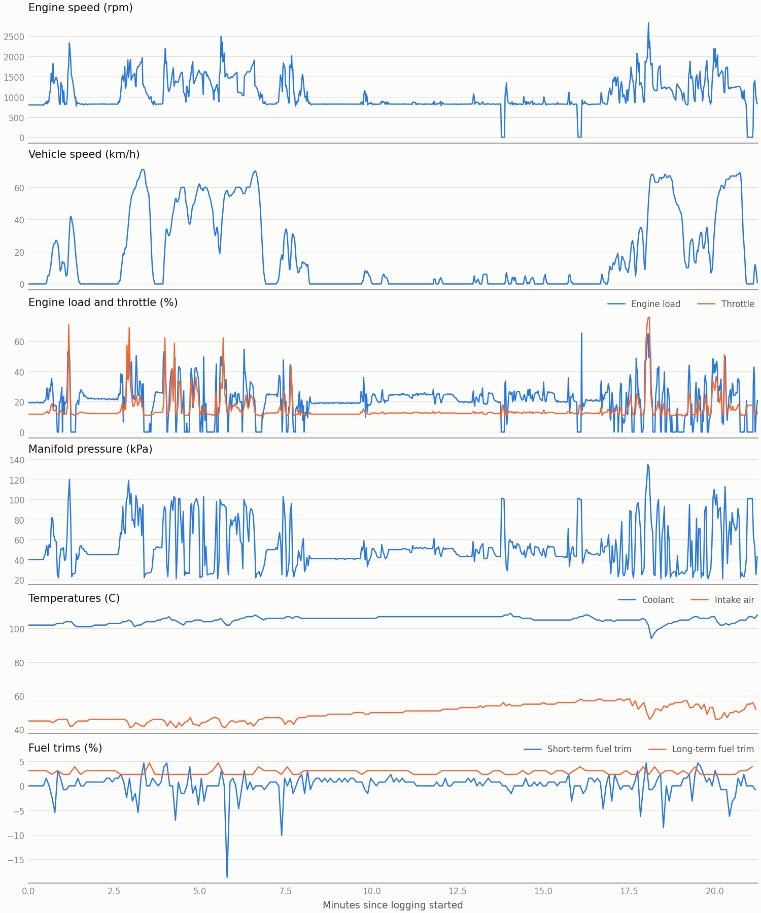

# can-logger

An embedded Linux data logger for a car's diagnostic CAN bus. A small Linux board plugs into a car's OBD-II port, polls standard OBD-II data over CAN, and writes it to storage as CRC-framed records. After a drive, a host-side tool checks the records and exports them as CSV.

## The stack
- Linux: a Raspberry Pi 5 with a dual-channel SPI CAN HAT, a device-tree overlay for the HAT, the kernel's SocketCAN and ISO-TP support, and systemd services for bring-up, restarts and a watchdog.
- C++: the logger itself - receive, poll scheduling, and storage on separate threads, with CRC-framed records.
- Python: a fake ECU on the second CAN channel so the logger can be developed and tested without the car, plus log decoding and drive reports.

## Safety
The logger only listens and sends standard read-only OBD-II requests. It never clears trouble codes, writes to a module, or opens a diagnostic session. Every new request type is tested against the bench ECU before it goes on the car.

## Which cars it fits
The logger uses OBD-II over CAN at 500 kbit/s with 11-bit IDs, and talks to the engine ECU on 0x7E0 and 0x7E8. Cars sold in the US have had to support OBD-II over CAN since the 2008 model year, and many use those settings, but it has only been tested on a 2017 Audi A4.

- Cars that use 29-bit IDs or another bit rate would need changes. Older cars on other OBD-II protocols won't work, and electric cars may not answer these requests.
- Which PIDs a car answers varies. `tools/car_info.py` lists them, and one the car doesn't support shows up as a missing or bad reply.
- On a new car, follow the order in [docs/car.md](docs/car.md), starting with listen-only. A controller in normal mode at the wrong bit rate can disrupt the bus.

## Status
Working in car, validated on one drive. On 2026-11-04 it logged 21.3 minutes in a 2017 Audi A4: 5,633 records from nine PIDs, which decoded with 0 bad and 0 missing, with 0 restarts. See the [drive report](docs/drive/report.md) and [docs/car.md](docs/car.md) for the results.

On the bench, the logger polls a fake ECU, shuts down cleanly and recovers from failures under systemd. A one-hour run wrote 15,742 records that decoded with 0 bad and 0 missing. See [docs/bench.md](docs/bench.md) for the setup and measurements and [docs/bom.md](docs/bom.md) for parts.

