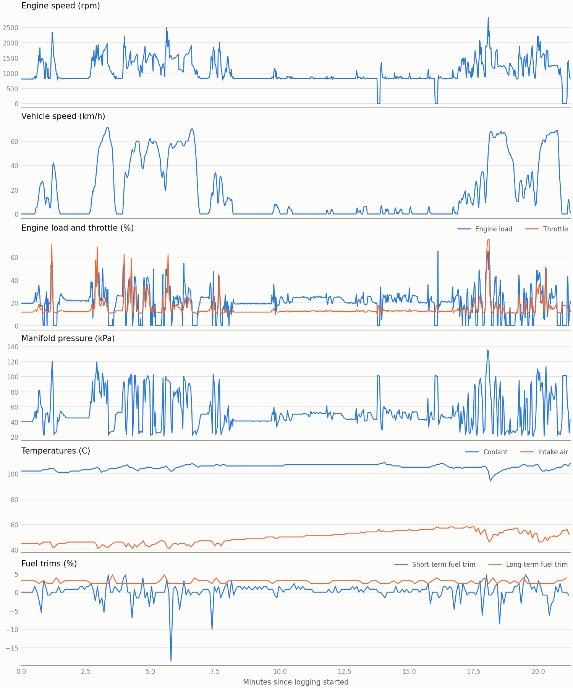

# Drive report

- Logged: 21.3 minutes, 5633 records
- Longest gap between records: 0.60 s
- Distance, from vehicle speed: 6.4 km
- Coolant: 102 C at the start, 108 C at the end

| PID | Value | Unit | Records | Min | Mean | Max |
|---|---|---|---|---|---|---|
| 0x04 | Engine load | % | 1172 | 0.0 | 20.6 | 65.1 |
| 0x05 | Coolant | C | 255 | 94.0 | 105.0 | 109.0 |
| 0x06 | Short-term fuel trim | % | 254 | -18.8 | 0.2 | 4.7 |
| 0x07 | Long-term fuel trim | % | 127 | 2.3 | 2.8 | 4.7 |
| 0x0B | Manifold pressure | kPa | 614 | 21.0 | 53.0 | 135.0 |
| 0x0C | Engine speed | rpm | 1172 | 0.0 | 1051.1 | 2825.0 |
| 0x0D | Vehicle speed | km/h | 1171 | 0.0 | 18.1 | 71.0 |
| 0x0F | Intake air | C | 254 | 41.0 | 49.7 | 58.0 |
| 0x11 | Throttle | % | 614 | 9.4 | 15.0 | 75.3 |

## Car info

- supported pids: 01 03 04 05 06 07 0B 0C 0D 0E 0F 11 13 15 1C 1F 21 23 2E 2F 30 31 33 34 3C 41 42 43 44 45 46 47 49 4A 4C 51 56 70
- stored dtcs: none
- pending dtcs: none
